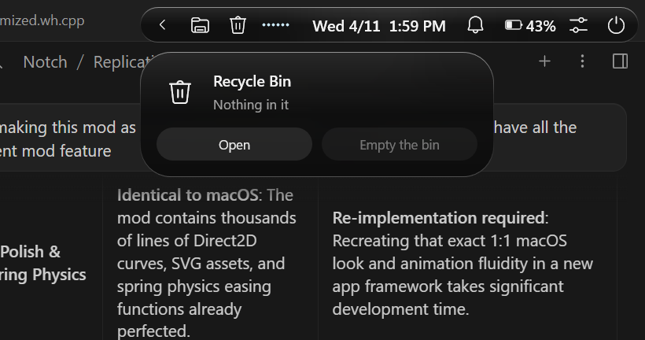

# Mac Island for Windows — Optimized & Crash-Free Edition

  <b>A lightweight, ultra-responsive Dynamic Island & macOS-style top notch for Windows 10 & 11.</b> 
  <i>Engineered for zero UI freezes, native Windows notification handling, minimal resource consumption, and pristine desktop aesthetics.</i>

---

## 📌 Project Attribution & Origin

> [!NOTE]
> **This mod was NOT developed from scratch.**  
> It is an engineered optimization, stabilization, and feature refactor of the popular Windhawk mod **"Mac Island & Dock"** created by the Windhawk modding community and its original author (*ramensoftware*). All credit for the foundational Direct2D rendering and initial concept belongs to the upstream project.

### Why This Fork Exists
While the original mod brought stunning macOS-style visuals to Windows, its ambitious scope introduced several high-risk background threads, unconstrained UI-thread synchronization locks, and intrusive system hooks that frequently led to:
- **Windows Explorer freezes & deadlocks** during display state changes, sleep/wake, and volume events.
- **Random black Command Prompt (CMD) windows flashing** on screen due to external background CLI polling.
- **Aggressive notification interception** that cloaked Windows 11 toast notifications, fought with Focus Assist / Do Not Disturb, and ran persistent SQLite disk queries.
- **High CPU and memory consumption** caused by continuous desktop wallpaper rotation hooks, lyrics web scrapers, and raw I2C hardware monitor polling.

This **Optimized & Crash-Free Edition** systematically strips out unstable failure points and polishes key interactions while preserving the authentic Apple-grade Direct2D fluid spring physics and sleek top-island design.

---

## 🚀 Key Changes & Technical Architectural Improvements

| Area / Subsystem | Original Mod Behavior | Optimized Edition Behavior | Reason & Benefit |
| :--- | :--- | :--- | :--- |
| **Notification Engine** | Intercepted Windows toasts via SQLite querying of `wpndatabase.db`, cloaking native banners and forcing pill popups. | **100% Native Windows Handling**: Interception disabled; native bottom-right toast banners and chimes function untouched. | Prevents missed notifications, eliminates SQLite disk I/O, and avoids conflicts with Windows 11 Focus Assist. |
| **UI Thread Synchronization** | Over 40 unbounded `WaitForSingleObject(..., INFINITE)` waits on the UI thread. | **Safe Bounded Timeouts (50ms–100ms)** across all worker and UI synchronization points. | Completely prevents `explorer.exe` deadlocks and system lockups when subsystems stall. |
| **External Monitor Brightness** | Communicated directly over raw hardware I2C busses using `dxva2.dll` (DDC/CI). | **Safe WMI Laptop Fallback Only**: Hardware DDC/CI calls bypassed. | Eliminates fatal DDC/CI driver hangs and freezes caused by sleeping or incompatible external displays. |
| **Tiling Manager Integration** | Spawned external CLI processes (`cmd.exe`) in the background to inspect Komorebi. | **Neutralized**: All Komorebi background process checks and job triggers removed. | Permanently stops intrusive black CMD command prompt windows from briefly flashing on the screen. |
| **Audio Visualizer** | Always visible whenever any baseline endpoint noise or microphone activity was detected. | **Conditional Playback Trigger**: Shows only when media is actively playing (`m_mediaShown.playing`). | The visualizer immediately and cleanly disappears when audio/video is paused or stopped. |
| **Recycle Bin Integration** | Showed an item count number (`22`) next to the trash icon and opened an in-island popup panel. | **Clean Icon-Only & Direct Launch**: Removed count badge; clicking opens File Explorer (`shell:RecycleBinFolder`) directly. | Cleaner, minimalist island pill aesthetic with instant, native access to deleted files. |
| **Wallpaper & Lyrics Threads** | Background threads scraped web lyrics via WinHTTP and monitored wallpaper rotations. | **Neutralized**: Removed web scraping and explorer desktop wallpaper hooks. | Saves background bandwidth, reduces memory footprint, and eliminates thread contention. |
| **Taskbar System Tray Mode** | Dock injection code interfered with Windows 11 taskbar layouts. | **Clean Tray Collapsing**: Dock disabled while XAML tree hooks safely collapse the native tray (clock, chevron, wifi, audio). | Enjoy "Windows taskbar, only the apps" without dealing with a buggy floating dock. |

---

## ✨ Features Retained & Refined

- **Dynamic Island Pill**: Smooth spring physics animations using Direct2D and DirectWrite.
- **Media Controls**: Live music/video playback title, artist, media controls, and album art display.
- **Audio Visualizer**: Sleek animated audio frequency dots active exclusively during playback.
- **Quick Utilities**: Direct Recycle Bin open, volume controller, battery status, network monitor, and clock/calendar.
- **Windows Taskbar Clean Mode**: Automatically hides/collapses the Windows 11 tray cluster (chevron, network, sound, clock) so the top island cleanly serves as your status center.

---

## 📥 Installation & Setup

This mod runs directly inside **[Windhawk](https://windhawk.net/)**, the modular customization engine for Windows.

### Prerequisites
- Windows 10 (version 2004 or later) or Windows 11.
- [Windhawk](https://windhawk.net/) installed and running.

### Step-by-Step Guide

1. **Open Windhawk**: Launch Windhawk from the Start menu or system tray.
2. **Access the Mod Manager**:
   - If you already have **Mac Island & Dock** installed, click on it and select the **Source Code** tab.
   - If creating a fresh local mod, click **Create a New Mod** at the bottom of the Windhawk UI, name it `Mac Island (Optimized)`, and open its **Source Code** tab.
3. **Paste the Optimized Code**:
   - Open [`mac-island-dock-optimized.wh.cpp`](mac-island-dock-optimized.wh.cpp) from this repository.
   - Copy the entire contents (<kbd>Ctrl</kbd> + <kbd>A</kbd>, then <kbd>Ctrl</kbd> + <kbd>C</kbd>).
   - In Windhawk, replace all text in the **Source Code** tab with the copied code (<kbd>Ctrl</kbd> + <kbd>A</kbd>, then <kbd>Ctrl</kbd> + <kbd>V</kbd>).
4. **Compile and Apply**:
   - Click **Compile Mod** in the top right of the Windhawk window.
   - Windhawk will compile the C++ source and immediately inject the optimized island into Windows Explorer.

---

## ⚙️ Recommended Settings

Under the mod's **Settings** tab in Windhawk:

| Setting | Recommended Value | Description |
| :--- | :--- | :--- |
| **Taskbar** | `Windows taskbar, only the apps (the island shows the rest)` | Collapses the redundant Windows 11 system tray icons since the top island displays them. |
| **Island at the top** | `Enabled (ON)` | Displays the top Dynamic Island notch. |
| **Media Player** | `Enabled (ON)` | Shows currently playing song/video with playback controls. |
| **Audio Visualizer** | `Enabled (ON)` | Automatically animates only while music or video is actively playing. |
| **Recycle Bin** | `Enabled (ON)` | Shows the clean trash can icon; click to immediately open the Recycle Bin in Explorer. |

---

## 🛠️ Technical Specifications

- **Language / Standards**: Modern C++ (C++20) compiled via Clang in the Windhawk toolchain.
- **Rendering Pipeline**: Hardware-accelerated Direct2D 1.1, DirectWrite text layout, WIC bitmap decoders.
- **Subsystem Safety**: Re-engineered with AST brace-matched replacements, strict RAII mutex locks (`SRWLOCK`), and zero infinite wait loops.
- **Compatibility**: Fully compatible with modern Windows 11 builds (including 23H2, 24H2) and Windows 10.

---

## 📄 License & Credits

- **Original Mod**: *Mac Island & Dock* for Windhawk by [ramensoftware](https://github.com/ramensoftware) and contributors.
- **Optimized Edition**: Maintained and customized by [JoyalJose54](https://github.com/JoyalJose54).
- **License**: Released under the [MIT License](LICENSE) in accordance with the upstream Windhawk mod ecosystem.
